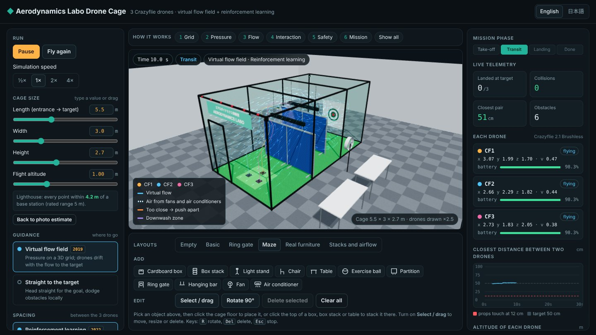
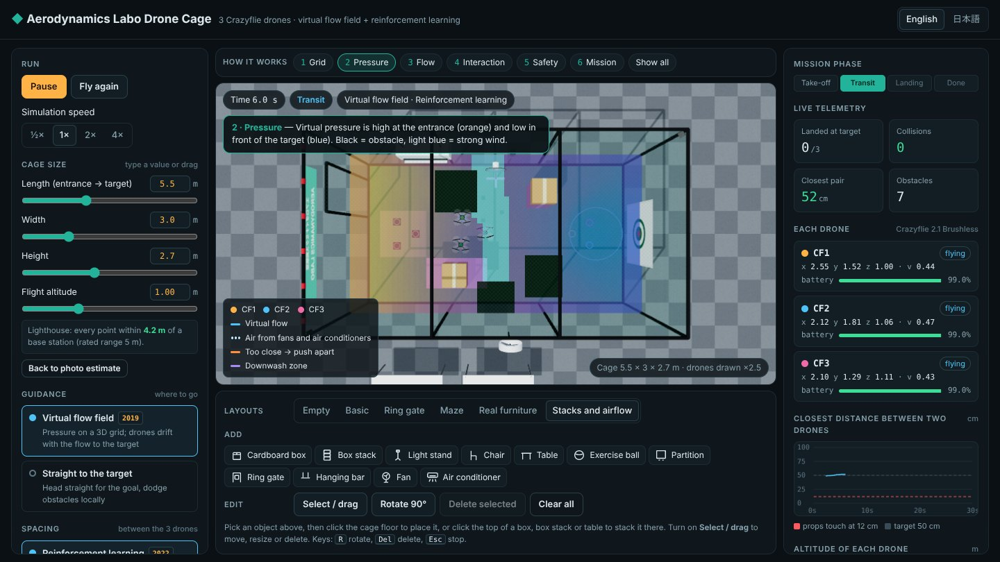
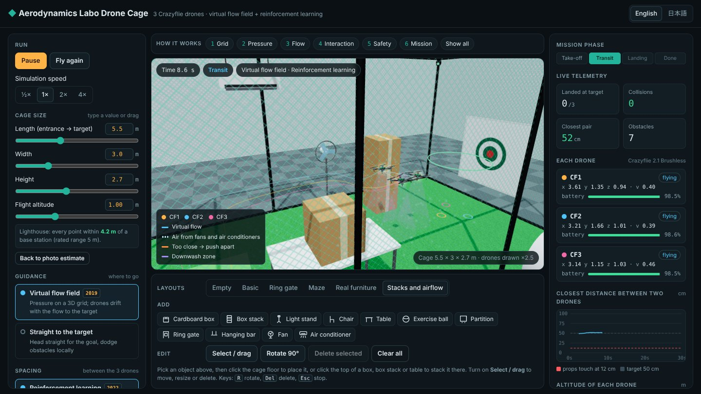

# Drone Swarm Simulation in the Aerodynamics Labo Cage

**Live demo:** [ti0246.github.io/drone-cage-sim](https://ti0246.github.io/drone-cage-sim/)



A 3D simulation, running in the web browser, of three Crazyflie 2.1 Brushless drones flying
through a digital twin of the Aerodynamics Labo net cage. It implements and compares the swarm
control methods of two published Cluster Dynamics patents:

* **WO 2019/131557**: a virtual pressure on a 3D grid gives a flow field that leads around
  obstacles to the target (grid method), plus virtual springs between drones (particle method).
* **JP 2022-147373 A**: reinforcement learning with a virtual interaction force; the learned
  model is used as a lookup table a = f(r, v).

日本語の説明は下にあります。

## Highlights

* **Digital twin of a real lab cage**: net, frame, turf, target and Lighthouse base stations;
  the cage size is adjustable and the Lighthouse coverage is checked against the 5 m range.
* **Both patent methods implemented and compared**: 3D virtual-pressure flow field, virtual
  springs, and a Q-learned interaction table, each switchable while the drones fly.
* **Obstacle editor**: 11 object types at real size, stacking with gravity, exact sizes by
  typed value, fans and air conditioners with their own airflow.
* **Robust flight**: safety layer, downwash avoidance, wind compensation and routing around
  strong air; 100 % success on all six ready-made layouts and 97–98 % on random layouts with fans.
* **Reproducible**: the same simulation files run in the browser and in Node.js, and the
  training script regenerates the learned table exactly.
* **English and Japanese** interface.

| | |
| --- | --- |
|  |  |
| Virtual pressure at flight altitude: orange at the entrance, blue at the target, black = obstacle, light blue = strong wind | Stacked boxes, a fan and an air conditioner; the drones lean against the wind |

## Built with

* JavaScript (plain scripts, no build step) and Three.js r147 for the 3D view
* Node.js for batch tests (`tools/run_benchmark.js`)
* Python and NumPy for the Q-learning (`tools/train_policy.py`)

## Credits

* Author: **Vu Van Thuc (Vũ Văn Thức)**, 3rd-year undergraduate, Daiichi Institute of Technology,
  Tokyo Ueno Campus (design, implementation, experiments)
* Supervisor: **Atsushi Kobayashi (小林 篤史)**, Aerodynamics Labo
* Developed with the help of an AI coding assistant (Claude by Anthropic).
* The control methods come from the published patents WO 2019/131557 and JP 2022-147373 A
  (Cluster Dynamics). This is an independent research and education simulation, not affiliated
  with or endorsed by Cluster Dynamics; the patent rights stay with their owners.

---

## How to run

| What | How |
| --- | --- |
| The simulation | Open `index.html` in Chrome or Edge. The 3D library (Three.js r147) and the fonts load from the internet. |
| Comparison test without a browser | `node tools/run_benchmark.js` (Node.js 16 or newer) |
| Learn the behaviour table again | `python tools/train_policy.py` (Python 3 with numpy; a few minutes) |

## Files

```
index.html               page layout: panels, buttons, 3D view (no logic)
style.css                look of the page
js/sim/                  THE SIMULATION — plain JavaScript, no browser needed
  config.js              every model parameter (drone, spacing, safety layer, time, grid)
  util.js                clamp, repeatable random numbers
  cage.js                cage size, take-off and landing areas, Lighthouse coverage
  obstacles.js           obstacle library, sizes, stacking, placement rules, ready-made layouts
  airflow.js             wind of the lab fan, placed fans and air conditioners
  scenario.js            everything one flight needs (solids, air, start, goal)
  flowfield.js           patent 2019, grid method: 3D grid, virtual pressure, flow direction
  policy-table.js        patent 2022: the learned table (data, made by tools/train_policy.py)
  policy.js              patent 2022: table lookup a = f(r, v)
  swarm.js               the three drones: control step, safety layer, mission, crashes
js/app/                  THE PAGE — 3D drawing and user interface (Three.js)
  state.js               what the user has chosen
  i18n.js                all texts in English and Japanese
  scene.js               renderer, camera, lights, the lab room and the cage
  models.js              3D models of the obstacles, fans, air conditioners and the Crazyflie
  overlays.js            flow lines, pressure map, grid cells, air dots, trails, links
  editor.js              placing, stacking, moving, turning, resizing obstacles
  controls.js            left panel: cage size, guidance, spacing, room conditions, layers
  panels.js              right panel: mission phase, live numbers, charts, event log
  steps.js               "How it works": six guided views
  compare.js             comparison test under the simulation
  main.js                start-up, life cycle of a flight, animation loop
tools/
  run_benchmark.js       comparison test for every layout in Node.js
  train_policy.py        Q-learning that made js/sim/policy-table.js
```

The `js/sim` files do not touch the page, so the same files run in the browser and in
`tools/run_benchmark.js`. All scripts are plain `<script>` files loaded in the order of
`index.html`; each file starts with a short explanation in English and Japanese.

## Reading order for the algorithm

1. `js/sim/config.js` — the numbers of the model
2. `js/sim/cage.js` and `js/sim/obstacles.js` — the world the drones fly in
3. `js/sim/flowfield.js` — how the virtual flow is computed (patent 2019)
4. `js/sim/policy.js` and `tools/train_policy.py` — the learned table (patent 2022)
5. `js/sim/swarm.js` — the control step that combines everything

## Where each patent idea is in the code

| Idea | Code |
| --- | --- |
| 3D grid, virtual pressure, Laplace equation solved by SOR | `solveFlowField()` in `js/sim/flowfield.js` |
| Flow direction −∇p followed by each drone | `flowDirectionAt()`; part 1 of `computeCommand()` in `js/sim/swarm.js` |
| Virtual spring–damper between drones (particle method) | part 2 of `computeCommand()`, setting "Virtual springs" |
| Reinforcement learning with a virtual interaction force | `tools/train_policy.py` |
| Learned model used as a table a = f(r, v) | `js/sim/policy-table.js`, `learnedAction()` in `js/sim/policy.js` |
| Safety layer, downwash avoidance (added by this project) | part 3 of `computeCommand()` |
| Leaning against the wind (added by this project) | `pushX/Y/Z` in `moveDrones()` and part 3 of `computeCommand()` |
| Flow goes around air too strong to fly through (added by this project) | `markStrongWind()` in `js/sim/flowfield.js` |

## One control step (every 0.02 s, `Swarm.step()`)

```
for each drone:
    a  = navigation          follow the virtual flow (or fly straight to the goal)
       + interaction         2 nearest drones: virtual spring–damper or learned table
    a  = limit(a, 65 % of the maximum acceleration)
    a += safety layer        obstacles and net push back, drones keep 28 cm apart, avoid downwash
    a -= estimated push      lean against the wind and downwash the drone has noticed
    a  = limit(a, maximum acceleration)
then: wind and downwash push → update the estimated push → new velocity → new position → battery → crash checks
```

## Units and coordinates

Metres and seconds. Inside the cage, x runs from the entrance to the target, y across the
cage and z up from the floor. Three.js uses y for up; `toScene()` in `js/app/scene.js` converts.

## Placement rules

* An object rests on the highest flat top (cardboard box, box stack or table) under its centre.
  The object put down last ends up on top; moving an object moves everything stacked on it;
  deleting it lets the objects above drop down.
* Every object stays at least 5 cm from the net, off the take-off pads and landing spots,
  and under the ceiling. A change that breaks a rule is undone.
* When the cage size changes, a ready-made layout is rebuilt to fit; a custom layout is kept,
  and objects that no longer fit are removed (the event log says how many).

## Airflow (simplified)

* Fan: round jet that widens and slows down over 3 m. Air conditioner: wide, flat jet tilted
  down by the louver angle, slowing down about as 1/√distance over 4 m.
* The wind pushes a flying drone with 1.6 m/s² for every 1 m/s of wind.
* Each placed fan or air conditioner has its own switch, direction (Rotate 90°), height and wind speed.

## Obstacle avoidance with many obstacles and wind

Tests with random layouts showed that obstacles alone are avoided well, but wind from fans and
air conditioners pushed drones into the net or held them still. Three additions fix this:

1. **Lean against the wind** (switch "Drones lean against the wind"): each drone estimates the
   steady push of wind and downwash from how it moves (0.3 s delay) and cancels it, as the
   integral term of a real position controller does.
2. **Go around strong air**: grid cells where the wind is stronger than a drone can fight count
   as obstacles in the flow field, unless that would close every way to the goal.
3. **More room around obstacles**: the grid margin is 15 cm, so the flow lines run further from
   surfaces and the drones stop less often in front of obstacles.

Setup A (flow field + learned table), 30 random layouts × 3 runs each:

| Random layout | before | after |
| --- | --- | --- |
| 10 partitions, stacks and tables | 100 % (1.1 s nearly stopped per run) | 100 % (0.1 s) |
| 12 objects including fans and air conditioners | 58 % | 98 % |
| same, plus the lab fan and position noise | 51 % | 97 % |

## Checking the results

`node tools/run_benchmark.js` flies every layout 10 times with the lab fan off and 10 times with
the lab fan and position noise on. With the default cage (5.5 × 3.0 × 2.7 m) it prints:

```
setup                                           success   crashes/run   closest pair   mission time
A  flow field + learned table (both patents)      100 %          0.00          17 cm         20.4 s
B  flow field + virtual springs (2019)            100 %          0.00          18 cm         20.3 s
C  flow field, no interaction                       8 %          1.84          11 cm         19.6 s
D  straight line + learned table                   74 %          0.00          19 cm         19.5 s
```

## Limits of the model

* Drones are points with an acceleration limit; attitude dynamics, motor lag and ground effect are not modelled.
* Wind, downwash and the soft net are simplified models; energy is a relative estimate.
* The learned table was trained on one pair of drones with a Q-table; the patent uses a DQN.
* Results should be confirmed in a physics simulator (Crazyswarm2) and in real flights.

---

# 日本語

エアロダイナミクス実験室のネットケージで、Crazyflie 2.1 Brushless 3機を飛ばす3Dシミュレーションです。
Cluster Dynamics社の2件の特許の手法を組み合わせています。

* **WO 2019/131557**：3D格子上の仮想圧力から、障害物を回り込んで的へ向かう流れ場を作る（格子法）。機体間の仮想ばね（粒子法）。
* **特開2022-147373**：仮想相互作用力を用いた強化学習。学習結果を表 a = f(r, v) として使う。

ケージのサイズ、障害物（積み重ね可能）、扇風機、エアコンはすべてページ上で変更できます。

## クレジット

* 作成者：**Vu Van Thuc（ヴー・ヴァン・トゥック）**、第一工科大学 東京上野キャンパス 3年（設計・実装・実験）／指導教員：**小林 篤史**（エアロダイナミクス実験室）
* AIコーディングアシスタント（Anthropic の Claude）の支援を受けて開発しました。
* 制御手法は公開特許 WO 2019/131557 と 特開2022-147373（Cluster Dynamics）に基づきます。本シミュレーションは研究・教育目的の独立したもので、Cluster Dynamics とは無関係です。特許権は各権利者に帰属します。

## 実行方法

| 内容 | 方法 |
| --- | --- |
| シミュレーション | `index.html` を Chrome または Edge で開く（3Dライブラリとフォントはインターネットから読み込み） |
| ブラウザなしの比較実験 | `node tools/run_benchmark.js`（Node.js 16 以上） |
| 行動表の再学習 | `python tools/train_policy.py`（Python 3 と numpy、数分） |

## ファイル構成

* `js/sim/` — **シミュレーション本体**。ページに依存しないため、ブラウザでも `tools/run_benchmark.js` でも同じファイルが動きます。
  `config.js`（パラメータ）、`cage.js`（ケージ）、`obstacles.js`（障害物・積み重ね・配置ルール）、`airflow.js`（扇風機・エアコンの風）、
  `flowfield.js`（格子法・仮想圧力）、`policy.js` と `policy-table.js`（学習済みの表）、`swarm.js`（3機の制御ステップ）。
* `js/app/` — **ページ**（3D描画と操作画面）。`editor.js`（配置・積み重ね・移動・サイズ変更）、`controls.js`（左パネル）、`panels.js`（右パネル）など。
* `tools/` — `run_benchmark.js`（比較実験）、`train_policy.py`（Q学習で行動表を作成）。

各ファイルの先頭に英語と日本語の説明があります。

## アルゴリズムを読む順番

1. `js/sim/config.js` — モデルの数値
2. `js/sim/cage.js`、`js/sim/obstacles.js` — 飛行空間
3. `js/sim/flowfield.js` — 仮想流れの計算（2019年の特許）
4. `js/sim/policy.js`、`tools/train_policy.py` — 学習済みの表（2022年の特許）
5. `js/sim/swarm.js` — すべてを組み合わせた制御ステップ

## 特許の考え方とコードの対応

| 考え方 | コード |
| --- | --- |
| 3D格子、仮想圧力、SORによるラプラス方程式の解法 | `js/sim/flowfield.js` の `solveFlowField()` |
| 各機が −∇p の流れに沿って進む | `flowDirectionAt()`、`js/sim/swarm.js` の `computeCommand()` パート1 |
| 機体間の仮想ばね・ダンパ（粒子法） | `computeCommand()` パート2（「仮想ばね」） |
| 仮想相互作用力を用いた強化学習 | `tools/train_policy.py` |
| 学習モデルを表 a = f(r, v) として使用 | `js/sim/policy-table.js`、`js/sim/policy.js` の `learnedAction()` |
| 安全層・ダウンウォッシュ回避（本プロジェクトで追加） | `computeCommand()` パート3 |
| 風の補正（本プロジェクトで追加） | `moveDrones()` の `pushX/Y/Z` と `computeCommand()` パート3 |
| 強い風を避ける流れ場（本プロジェクトで追加） | `js/sim/flowfield.js` の `markStrongWind()` |

## 1回の制御ステップ（0.02秒ごと）

誘導（仮想流れ）＋相互作用（ばね または 学習済みの表）を最大加速度の65%に制限し、安全層（障害物・ネット・機体間・ダウンウォッシュ）を加えて最大加速度に制限します。
さらに、各機が推定した風・ダウンウォッシュの力を打ち消します。その後、風とダウンウォッシュの影響を加えて速度・位置を更新し、電池と衝突を判定します。

## 配置のルール

* 物体は中心の真下にある最も高い平らな上面（段ボール箱・箱の山・机）の上に載ります。最後に置いた物体が一番上になり、物体を動かすと上に積んだ物体も一緒に動きます。
* ネットから5 cm以上離し、離着陸エリアを避け、天井より低くします。ルールに反する変更は取り消されます。
* ケージのサイズを変えると、既製の配置は新しいケージに合わせて作り直され、自分で置いた配置はそのまま残ります（入らない物体は削除され、イベントログに表示）。

## 気流（簡略モデル）

扇風機は3 mで広がり弱まる円形の噴流、エアコンはルーバー角度だけ下向きの幅広く薄い噴流（4 m）。風速1 m/sごとに機体を1.6 m/s²で押します。
置いた扇風機・エアコンはそれぞれ運転のオン・オフ、向き（90°回転）、高さ、風速を設定できます。

## 障害物が多いとき・風があるときの回避

ランダム配置の試験では、障害物だけなら問題なく回避できましたが、扇風機やエアコンの風で機体がネットに押し付けられたり止まったりしました。次の3つを追加しました。

1. **風に逆らって飛ぶ**（「風の補正」スイッチ）：各機が自分の動きから風・ダウンウォッシュの力を推定し（遅れ0.3秒）、打ち消します。実機の位置制御の積分項と同じ働きです。
2. **強い風を避ける**：機体が逆らえないほど風が強い格子セルを、流れ場では障害物として扱います（目標への道がなくなる場合は除く）。
3. **障害物との距離を広げる**：格子の余裕を15 cmにして、流れの線を表面から離しました。障害物の前で止まる時間が減ります。

構成A（流れ場 + 学習済みの表）、ランダム配置30通り × 各3回の成功率：

| ランダム配置 | 追加前 | 追加後 |
| --- | --- | --- |
| パーティション・箱の山・机など10個 | 100 %（停止に近い時間 1.1 秒/回） | 100 %（0.1 秒） |
| 扇風機・エアコンを含む12個 | 58 % | 98 % |
| 同上 + ネット外の扇風機と測位雑音 | 51 % | 97 % |

## モデルの限界

機体は加速度制限付きの質点です。風・ダウンウォッシュ・ネットは簡略化したモデルで、電力量は相対的な推定値です。
行動表は2機1組のQ表で学習しました（特許はDQN）。物理シミュレータ（Crazyswarm2）と実飛行での確認が必要です。
